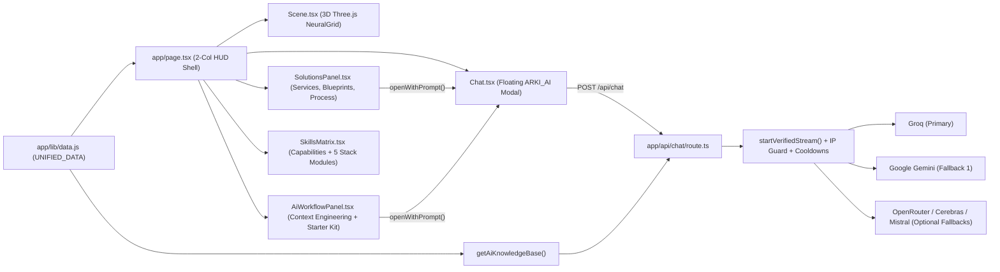

# System Architecture — `noaligpitan-dev26`

## 1. Overview & Tech Stack

- **Application:** Personal developer & business-automation portfolio for **Noa Ligpitan** (*Full-Stack Developer & Business Automation Architect*).
- **Framework:** Next.js `16.2.2` (App Router), React `19.2.4`, TypeScript `5`
- **Styling & Animation:** Tailwind CSS `v4` (`@tailwindcss/postcss`), Framer Motion `12`, Lucide Icons, React Icons
- **3D WebGL Background:** Three.js `0.183`, `@react-three/fiber` `9`, `@react-three/drei` `10`
- **AI Streaming:** Vercel AI SDK `v6` (`ai`, `@ai-sdk/react`, `@ai-sdk/groq`, `@ai-sdk/google`, `@ai-sdk/openai`)
- **Persistence / Database:** None currently. Portfolio data is static in `app/lib/data.js`; chat messages live in client React state; IP throttling & model cooldowns are server in-memory maps.

---

## 2. High-Level Architecture & Data Flow



---

## 3. Repository Structure

```text
noaligpitan-dev26/
├── AGENTS.md                               # Always-on root rules pointing to context/
├── CLAUDE.md                               # Imports @AGENTS.md
├── context/                                # Central AI instructions, architecture & roadmap hub
│   ├── README.md                           # Index of context/ files
│   ├── AI_INSTRUCTIONS.md                  # Engineering rules, guardrails & verification steps
│   ├── ARCHITECTURE.md                     # This file (stack, diagrams, file map, AI pipeline)
│   ├── FLOWS.md                            # Visual end-to-end flow diagrams & file traces
│   ├── DECISIONS.md                        # Architecture Decision Records (ADRs)
│   ├── APP_CONTEXT.md                      # Living feature inventory & dated change log
│   └── ROADMAP.md                          # Prioritized portfolio TODOs & job-readiness plan
├── .agents/
│   ├── hooks.json                          # PreToolUse command-policy hook config
│   ├── scripts/
│   │   ├── command-policy.mjs              # Denies .env leaks/force-push, force-asks install/delete, auto-allows tsc/eslint/build & build-and-push
│   │   └── build-and-push.mjs              # Single-command build-gated git add, commit & push helper (aborts if next build fails)
│   └── skills/
│       ├── sync-app-context/SKILL.md       # Workflow: audit repo & update context/ docs
│       ├── add-portfolio-feature/SKILL.md  # Workflow: build, verify & track new features
│       ├── update-portfolio-data/SKILL.md  # Workflow: update UNIFIED_DATA & AI knowledge base
│       ├── roadmap-picker/SKILL.md         # Workflow: interactive clickable picker for ROADMAP.md tasks
│       ├── debug-ai-chat/SKILL.md          # Workflow: diagnose AI providers, models & streams
│       ├── health-check/SKILL.md           # Workflow: pre-deploy tsc, eslint & repo audit
│       ├── explain-flow/SKILL.md           # Workflow: trace & explain any app flow visually
│       └── git-commit-push/SKILL.md        # Workflow: scan diff, clickable commit msg picker, approve & push
├── app/
│   ├── layout.tsx                          # Root layout, Geist fonts, SEO metadata
│   ├── globals.css                         # Tailwind v4 entry + .custom-scrollbar & .no-scrollbar
│   ├── page.tsx                            # Widescreen 2-column HUD layout + 6-tab panel
│   ├── api/
│   │   ├── AGENTS.md                       # Scoped API & AI streaming rules
│   │   └── chat/
│   │       └── route.ts                    # Streaming AI route + preflight fallback + rate limit
│   ├── components/
│   │   ├── AGENTS.md                       # Scoped UI, Tailwind v4 & React 19 rules
│   │   ├── Scene.tsx                       # Full-screen 3D Three.js NeuralGrid background
│   │   ├── Chat.tsx                        # Floating ARKI_AI popup modal + markdown + error alerts
│   │   ├── streaming-text.ts               # [Unused scratch file — scheduled for cleanup]
│   │   └── sections/
│   │       ├── SolutionsPanel.tsx          # Filterable Business/Personal services, blueprints & CTA
│   │       ├── AiWorkflowPanel.tsx         # Context Engineering showcase, guardrails & copyable starter kit
│   │       ├── SkillsMatrix.tsx            # Core operational capabilities + 5 tech stack modules
│   │       ├── Navbar.tsx                  # [Unused prototype — scheduled for cleanup]
│   │       └── FeatureWork.tsx             # [Unused prototype — scheduled for cleanup]
│   └── lib/
│       └── data.js                         # Single source of truth (UNIFIED_DATA + getAiKnowledgeBase)
└── public/                                 # Profile portraits, favicons, site.webmanifest
```

---

## 4. AI Chat Pipeline (`app/api/chat/route.ts`)

1. **Per-IP Rate Limiting:** In-memory sliding window (`25` requests/hour per IP); returns HTTP `429` with structured JSON `{ code: "RATE_LIMIT", error }`.
2. **Configured Chain Filtering:** Filters `MODEL_CHAIN` to providers with non-empty API keys in `.env.local` so unconfigured optional providers are silently skipped.
3. **Fallback Order:**
   - **Groq:** `qwen/qwen3.8-27b` -> `openai/gpt-oss-20b` -> `openai/gpt-oss-120b`
   - **Google Gemini:** `gemini-2.5-flash-lite` -> `gemini-2.5-flash`
   - **OpenRouter (optional):** `openrouter/free`
   - **Cerebras (optional):** `gpt-oss-120b`
   - **Mistral (optional):** `mistral-small-latest`
4. **Preflight Verification (`startVerifiedStream`):** Pulls chunks up to the first output chunk (`text-delta` / `reasoning-delta` / `tool-input-*` / `finish`) before returning HTTP `200`, ensuring `404`, `401/403`, `429`, `503`, and timeout failures cleanly trigger fallback and model cooldowns.
5. **Client Feedback (`Chat.tsx`):** Reads `X-Model-Used` and ASCII-safe `X-Fallback-Notice` headers, displays reasoning state for thinking models, renders lightweight inline markdown, and shows an expandable `SYSTEM_ALERT` card with retry when all providers fail.

---

## 5. Environment Variables (`.env.local`)

| Variable | Provider | Required? |
| :--- | :--- | :--- |
| `GROQ_API_KEY` | Groq (Primary) | At least one provider key required |
| `GOOGLE_GENERATIVE_AI_API_KEY` | Google AI Studio / Gemini | Optional (recommended fallback) |
| `OPENROUTER_API_KEY` | OpenRouter (`openrouter/free`) | Optional |
| `CEREBRAS_API_KEY` | Cerebras | Optional |
| `MISTRAL_API_KEY` | Mistral | Optional |
| `NEXT_PUBLIC_SITE_URL` | Used as OpenRouter `HTTP-Referer` | Optional (defaults to `http://localhost:3000`) |
