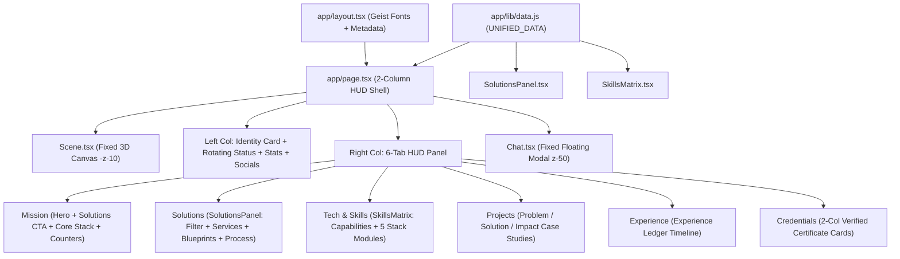
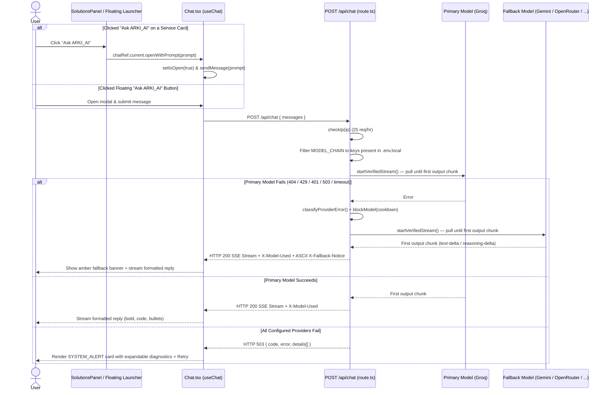
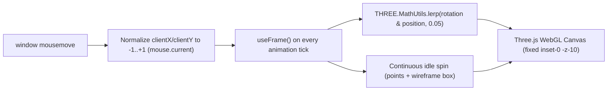
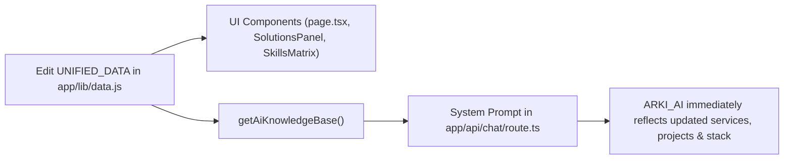

# End-to-End Application Flows — `noaligpitan-dev26`

> Visual and step-by-step traces showing how data, events, UI interactions, and AI streaming move across the app.

---

## 1. Portfolio Render & Tab Navigation Flow

**Key Touchpoints:**
- `app/page.tsx`: Holds `activeSection` (`mission | solutions | skills | projects | experience | credentials`), `statusIndex` (rotates availability badge every 3s), and `chatRef` (`ChatHandle`).
- Responsive behavior:
  - **Desktop (`lg+`):** Fixed-viewport 2-column grid (`4/8`, `xl: 3/9`, `max-w-[1640px]`), independent vertical scrolling inside the content panel (`.custom-scrollbar`).
  - **Mobile (`< lg`):** Stacked vertical layout with single-row horizontal swipe strips (`.no-scrollbar`) for stats, social links, section tabs, and Solutions audience filters.

---

## 2. `ARKI_AI` Chat, Deep-Link & Multi-Provider Fallback Flow

**Key Touchpoints:**
- `app/components/Chat.tsx`: Imperative `ChatHandle.openWithPrompt()`, `DefaultChatTransport` custom `fetch` wrapper reading `X-Model-Used` / `X-Fallback-Notice` and parsing JSON errors, lightweight markdown renderer (`renderFormattedLine`), and `SYSTEM_ALERT` card.
- `app/api/chat/route.ts`: `checkIp()`, `getProviderApiKey()`, `startVerifiedStream()`, `classifyProviderError()`, `toSafeHeaderValue()`, and `createUIMessageStreamResponse()`.

---

## 3. 3D Background Interaction Flow (`Scene.tsx`)

**Key Touchpoints:**
- `app/components/Scene.tsx`: Listens on `window` (not the canvas) so cursor tracking continues smoothly even when hovering over foreground UI panels.

---

## 4. Single Source of Truth Update Flow (`app/lib/data.js`)

**Rule of Thumb:** Whenever you add a new field or section to `UNIFIED_DATA`, check `getAiKnowledgeBase()` at the bottom of `app/lib/data.js` so `ARKI_AI` learns about it automatically.
